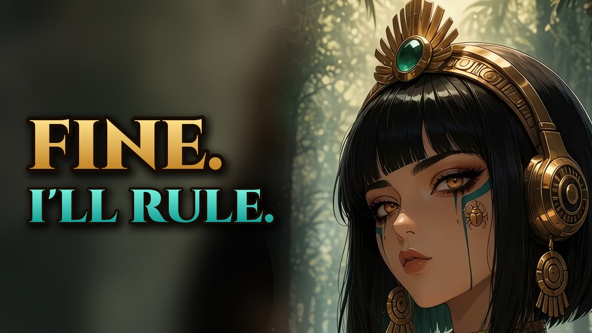
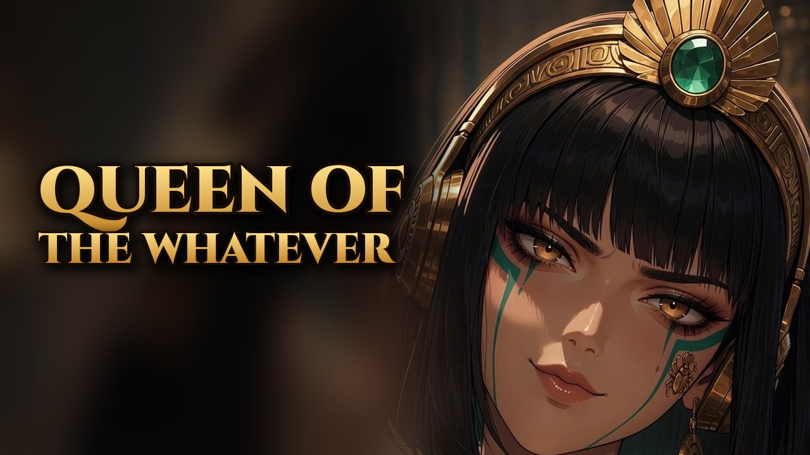
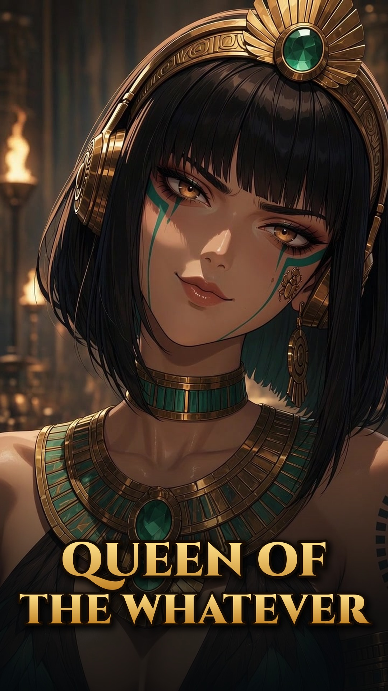

# ARTAPOELC homage

A fan-made music video for [Julie Lacroix](https://www.youtube.com/watch?v=rbUCvPwMruU)'s song **ARTAPOELC**.

**The song and its rights, and the original video, belong to Julie Lacroix.** This project is an unofficial fan homage and a gift for her. It is not affiliated with her, not endorsed by her, and claims no rights to the song or the original video. Julie, thank you for the song. This one's for you.

Original song and video: [https://www.youtube.com/watch?v=rbUCvPwMruU](https://www.youtube.com/watch?v=rbUCvPwMruU)

## Make your own

This video was directed by a music-video bot built from the [Tempotage template](https://x.ai/bot/0MgEiSVzQaByzMurkhxSs). Anyone can start from the same template and make their own.



This write-up is a full, honest record of how the homage was made: the timeline, the tools, the people and agents, the prompts we actually have, the generation counts, the 4K pass, the usage readings, and what we learned. Every number comes from a log, a progress file, or a usage report. Where a number was never recorded, this page says so instead of guessing. All times are Pacific Time (PT).

## Contents

- [Make your own](#make-your-own)
- [The finished piece](#the-finished-piece)
- [The story and the tone](#the-story-and-the-tone)
- [Timeline](#timeline)
- [Tools](#tools)
- [How a take was checked (LOOK)](#how-a-take-was-checked-look)
- [Agents and roles](#agents-and-roles)
- [Generation counts](#generation-counts)
- [4K stats](#4k-stats)
- [Prompts](#prompts)
- [Usage and tokens](#usage-and-tokens)
- [Lessons learned](#lessons-learned)
- [Appendix A: shot plan v1](#appendix-a-shot-plan-v1)
- [Appendix B: beat sheet v1 (earlier planning document)](#appendix-b-beat-sheet-v1-earlier-planning-document)
- [Appendix C: hero choice](#appendix-c-hero-choice)
- [Appendix D: the cut, 39 segments](#appendix-d-the-cut-39-segments)
- [Appendix E: sample per-take LOOK notes](#appendix-e-sample-per-take-look-notes)

## The finished piece

| | |
|---|---|
| Final file | `ARTAPOELC homage 4K.mp4`, in the folder `ARTAPOELC homage/4K`, on the home PC used for the upscale (an RTX 5060 Ti) |
| Picture | H.264 High, 2160×3840 vertical (9:16), 24 fps, 6,888 frames |
| Length | 287.000 s (4:47), cut to the length of the song |
| Audio | Julie Lacroix's song, AAC 48 kHz stereo, copied over without re-encoding |
| Size | 1,414,373,490 bytes |
| SHA-256 | `ddf543f90b0967b976268d60e67e0c57ad738b80c6cb5617145ee5cf7bd50cdc` |
| Approved cut (720p, with song) | 720×1280, 285,754,373 bytes, SHA-256 `1950f27351d54b6659e218ef8b399b5c0462689e55f3f99e70916537d5798c08` |
| Silent master (720p) | 274,336,730 bytes, SHA-256 `e71ce355ad9925ebcf6aa4327e61a394a2614321297c12c2ef9a27cb3fdf5cfe` |

The picture was built silent first, then a separate copy had her song laid underneath as the gift. Brent posted the finished video himself. No agent posted or uploaded it anywhere public.




The finished video is vertical. This 9:16 thumbnail shows the costume more fully: feather bodice, gold and teal collar, gold sunburst headdress, gold headphones, teal tear-streak paint, and the gold scarab tattoo under her left eye.



## The story and the tone

A queen who does not want the throne. In slots 1 to 13 she escapes and dodges. Slots 14 to 28 are a push and pull between duty and freedom. In slots 29 to 31 she owns it: she crowns herself, raises a toast, and winks.

Brent's tone rule: the lyrics are dark, but nothing on screen plays dark unless it's also funny. Blood becomes pomegranate juice, the cobra becomes her deadpan pet, the tomb becomes a nap pod, and the dagger slices a mango. Her paint flecks are always gold, never red. She is an adult in every shot. (Brent noted that the artist skipped making a video herself because she worried it would come out too dark.)

## Timeline

### Sunday, November 8: studying the song

From about 5:22 to 5:29 PM, the official video was downloaded and its audio was decoded to WAV for a local production study. Nothing was uploaded or published. That study is where the song file used later came from. It measured:

- Length: 287.05 s.
- Tempo: 125 BPM, from an independent librosa beat tracker plus long-window onset periodicity.
- Levels: peak, root-mean-square, and true peak.
- Stereo: correlation and mid/side balance.
- Spectrum: band energy shares.
- The layered low "panther" drum: a pitch-dropping kick plus a separately sustained sub.

The finished cut is 287.000 s, described in the logs as the exact length of the song. The study's 287.05 s reading and the finished 287.000 s file differ by five hundredths of a second.

### Monday, November 9 morning: paper before pixels

- **10:22 AM.** A reference copy of the official video was pulled with yt-dlp (format 137+140). YouTube auto-captions were saved. A frame was grabbed every 2 s so the lyric captions burned into the official video could be read (OCR, then reading by eye). A local Whisper transcription was made from 10:23 to 10:34 to fill in words cut off on screen. No published lyric sheet could be found, so every lyric in the plan comes from what's on screen, and filled-in words are marked as transcribed.
- **About 10:26 to 10:27.** Hero portraits A, B, and C, plus a full-body costume sheet, were generated with GenerateImage. Portrait B was picked.
- **10:27.** Beat sheet v1 was written (29 beats; see [Appendix B](#appendix-b-beat-sheet-v1-earlier-planning-document)).
- **About 10:30.** Brent set the theme as her reluctance to take the throne. He asked for a silent build first, with a copy carrying her song as a gift if it turned out good enough.
- **10:31.** A 10-clip first batch was generated. The later shot plan mapped three of those clips to slots.
- **About 10:33.** Brent added the rule that every shot's action comes from the lyric under it, and that the humor has to come from what she does.
- **10:35.** Shot plan v1 was written: 31 slots. The full table is in [Appendix A](#appendix-a-shot-plan-v1). This is the plan the video was cut to, and it supersedes the earlier beat sheet.
- **10:39.** Keyframe generation began.
- **10:56.** The hero choice was locked in `hero/CHOSEN.txt` (see [Appendix C](#appendix-c-hero-choice)).
- **Late morning to 12:34 PM.** The first worker (A1) made and LOOK-checked the first takes for slots 1 to 10.

### Monday, November 9 midday: the generation burn

- **About 12:37 to 12:40 PM.** Four parallel generation lines took over, split by song section. Weekly usage read 34.1%. That is the earliest reading found; there is no reading from before the burn.
- **About 1:45 to 1:53 PM.** Brent set a new stop rule: keep generating until 99% of weekly usage or 3:00 PM, whichever comes first, and use no extra or on-demand credits.
- **1:56 PM.** A fifth line ("X alts") started at 55.5%. It made alternate takes for the choruses, the headdress off/on beat, the throne hesitation, and "owns the throne".
- **About 2:30 PM.** All four section lines restarted after an interruption and resumed from their progress files.
- **2:42 PM.** A scheduled burn check recorded 85.6% and 494 clips in `clips/`.
- **3:00 PM.** No new generation started after this. Last reading: 91.3% at 3:02 PM.
- **3:10 PM.** The weekly limit reset.

### Monday, November 9 afternoon: curation and the cut

- **3:20 PM.** The last 48 clips nobody had checked yet were LOOK-checked. That made verdicts for all 564 clips: 454 PASS, 96 partial, 14 FAIL.
- **3:23 PM.** All 70 X alt clips were on the home PC and hash-checked (70 OK, 0 bad).
- Then the keeper list, the shortlist, and contact sheets were built:
  - `keepers 420.md`: exactly 420 clips, which is the number Brent asked for (406 PASS plus 14 strong partials, no FAILs).
  - `shortlist v1.md`: 31 slots, each with a best take and a backup.
  - Best-pick contact sheets.
- Brent reviewed the stills: they "look amazing", and the 31-shot selection was approved for the silent rough cut.
- **5:00 PM.** `rough cut v1 silent.mp4` was built with ffmpeg: 39 segments, hard cuts only, 287.0 s, 6,888 frames at 24 fps.
- **5:10 PM.** The rough cut was LOOK-checked, which found two fixes: an empty wall shot at 1:40, replaced with 1 s of the nap take; and a near-jump cut at 4:26, replaced with a close sip. It was rebuilt at 287.0 s.
- **5:30 PM.** All 420 keepers were on the home PC and matched their SHA-256 manifest (0 bad, 0 missing, 0 extra).
- **5:59 PM.** The silent rough cut was on the home PC and its hash matched.
- **About 6:08 PM.** Brent watched the silent cut and called it his favorite video ever: "Disney quality".
- **6:08 PM.** A private review copy with her song laid underneath was built with ffmpeg and shared with Brent privately in three parts for review.
- **6:18 PM.** The version with her song was on the home PC and its hash matched.
- **About 6:25 PM.** Brent watched it from his own drive and said "perfect, upscale it to 4K".

### Monday, November 9 evening: 4K and posting

- Shortly after the 6:18 PM copy landed (the log writes the launch as "about 6:2x PM"), the 4K runner launched on the home PC, hidden and in the background.
- **6:26 PM.** All 6,888 frames were extracted to PNG.
- **6:30 PM.** A runner bug stopped the run after 301 frames (see [Lessons learned](#lessons-learned)).
- **6:33 PM.** The fixed runner relaunched and resumed at frame 302 without redoing any frames.
- **7:04 PM.** The upscale finished, 6,888 of 6,888 frames. The encode began at the same time.
- **About 7:15 PM.** The agent watching the job was cut off. The runner itself kept going. A new watcher checked in and found no relaunch was needed.
- **7:42 PM.** The encode finished, about 38 minutes after it started.
- **7:50 PM.** A full LOOK passed (see the 4K checks under [How a take was checked](#how-a-take-was-checked-look)).
- **About 7:54 PM.** Brent: "so good". He posted it himself. No agent posted or uploaded it anywhere public.

## Tools

| Tool | What it did here |
|---|---|
| yt-dlp | Pulled the official video (format 137+140) as the reference and as the song source for the gift copy. |
| Python with librosa, numpy, and scipy | Studied the song (tempo, levels, spectrum, kick) on November 8. |
| Whisper (local) and YouTube auto-captions | Filled in lyric words cut off on screen. Burned-in captions were read from frames every 2 s. |
| **GenerateImage** | Made the hero portraits (A, B, C), the full-body costume sheet, and 89 per-shot keyframe stills (58 marked PICK). Each keyframe used both hero references and was 9:16. It also made end-frame stills for first/last-frame clips, such as a true one-eye wink and a cobra nod. |
| **Grok Imagine (GenerateVideo)** | Image-to-video, 10 s, 720×1280, from a PICK keyframe. Also used: first/last-frame pairs (start keyframe plus end still) and continuation takes started from a previous take's last frame. 564 clips in total. |
| ffmpeg / ffprobe | Contact sheets and strips, silent copies, trimming the 39 segments, the hard-cut rough cut, laying the song under the picture, the 4K encode, and every check (blackdetect, PSNR, stream probes, audio packet MD5). |
| Real-ESRGAN `realesr-animevideov3`, ×3 (ncnn-vulkan) | The 4K upscale on the home RTX 5060 Ti: 720×1280 to 2160×3840 in chunks of 300 frames, at about 3.4 fps (300 frames in 87 s). |
| PowerShell runner (`run 4K.ps1`) | A resumable 4K pipeline: extract, upscale, then encode to a "partial" file that is renamed only when it finishes. It skips any frame already done. |
| SHA-256 manifests | Every copy from the build machine to the home PC was hash-checked against a manifest on the far side. |
| File copy and tar | Moved files from the build machine to the home PC, in chunks (see Lessons). |

The shot plan also flagged three slots as Blender or compositing candidates, if image-to-video couldn't hold the staging: the lagging reflection (slot 11), the chibi mural (slot 20), and the pyramid rising on a locked pose (slot 21). Blender was not used. Those beats were solved with tighter keyframes and more takes.

## How a take was checked (LOOK)

"LOOK" means a person-style visual check of the real frames before anything is called done. It was used at every stage.

**Per take:**

- 1 fps 5×2 strips covering the whole 10 s clip.
- 1/5/9 s sheets.
- Viewing at 2 fps.
- Zoomed crops of faces and hands.
- 0.2 s zoomed strips wherever something looked off.

Each take got PASS, PARTIAL, or FAIL with a clean range in seconds, ±0.5 s. Typical failures were:

- props morphing: a knife shrinking, a mirror swapping hands, a crown turning into a fan or halo;
- extra people appearing: warriors multiplying, an attendant popping in;
- identity or costume drift: a cream cobra, a teal dress;
- camera or background morphs;
- broken rules: a spin, a high kick.

**Rough cut:**

- a contact sheet every 2 s;
- a sheet of every cut point;
- blackdetect.

**4K:**

- ffprobe of both streams, both starting at 0.000.
- Audio packet MD5 compared with the source: identical.
- PSNR of the 4K (area-downscaled to 720) against the approved 720 cut over all 6,888 frames: average 39.2 dB, minimum 36.1 dB. That means every frame lines up, with nothing dropped or shifted.
- blackdetect: clean.
- 31 frames (every 10 s plus both ends), 6 face crops, and a 1:1 crop of the eye and gem, all checked for sharp linework, no mush, consistent identity, clean gems, headdress, scarab and tear paint, and no banding in dark shots.
- faststart: the index (moov atom) is at the front of the file.

## Agents and roles

| Agent | Role |
|---|---|
| **Brent** (human) | Creative lead. Set the theme, the tone rule, the stop rules, and the 420-keeper target. Approved stills, cut, song version, and 4K. Posted it himself. |
| **Director** (Tempotage, the video bot) | Studied the song, read the lyrics, wrote the beat sheet and shot plan, picked the hero, launched and supervised the lines, ran the burn checks, ran curation and the cut, laid in the song, and watched the 4K run. |
| **Line A1** (`c01`–`c10`, `b1`) | Slots 1–10, 0:00–1:12. Taken over by a second worker (A1b) at 12:38 PM. 135 clips (plus 5 early clips for later slots that were handed to A2 and B). |
| **Line A2** | Slots 11–19, 1:12–2:24. 110 clips. |
| **Line B** | Slots 20–26, 2:24–3:43. 137 clips. |
| **Line B2** | Slots 27–31, 3:43–4:47. 107 clips. |
| **Line X alts** | Alternates for choruses, headdress off/on, the throne hover, and "owns the throne". 70 clips, 1:56–3:00 PM. |
| **Curation** | LOOKed the 48 clips nobody had checked yet, compiled verdicts for all 564, then built the 420 keepers, the 31-slot shortlist, the rough cut, and the copy with the song. |
| **Upscale / 4K** | Wrote and ran the resumable Real-ESRGAN runner on the home PC, fixed the runner bug, watched the encode, and did the final LOOK. |
| **Burn check** (scheduled) | Recorded usage, clip counts, and line status on a schedule. It stopped at 99% or 3:00 PM, and the 2:42 PM check was the last one. |
| **Phoenix** | Compiled this public write-up from the production dossier. |

Each line wrote its own resumable progress file (`progress 0000-0112.md`, `progress 0112-0224.md`, `progress 0224-0336.md`, `progress 0336-end.md`, `progress X alts.md`, `progress curation.md`, `progress 4K.md`). When a worker was cut off, a new one read the file and carried on from there.

The progress-file names for the last two section lines (`0224-0336` and `0336-end`) do not match the final split used in the shot plan (Line B is 2:24–3:43, Line B2 is 3:43–4:47). The logs do not explain the 3:36 vs 3:43 difference. The slot ranges above are the ones the lines actually covered.

## Generation counts

| | Count |
|---|---|
| Clips generated | **564** (494 story clips in `clips/` + 70 X alt takes) |
| By line | A1 135, A2 110, B 137, B2 107, early strays 5, X 70 |
| LOOK verdicts | **454 PASS, 96 partial, 14 FAIL** |
| Keepers | **420** (406 PASS + 14 strong partials) |
| Slots in the shot plan | **31** |
| Segments in the cut | **39** (A1 10, A2 10, B 8, X 2, B2 9) |
| Keyframe stills | 89 files (A1 26, A2 23, B 22, B2 18), 58 marked PICK |
| Hero stills | 3 portraits + 1 full body |
| Clip spec | 10.04 s, 720×1280, image-to-video |
| Known server-side failures | Several single requests failed with server errors and were retried once (for example 2 in A1 batch N2, 2 in B2 batch 2, 2 in X batch 2, 1 in B batch 12). B batch 8 was interrupted, and 3 of its 5 clips were recovered from assets. One prompt was blocked by the content filter: the cape sliding off her shoulders in slot 8. It was reshot from a "cape left behind" keyframe, and later a "cape drop" keyframe worked. |

The line counts add up: 135 + 110 + 137 + 107 + 5 + 70 = 564. The verdicts add up: 454 + 96 + 14 = 564. The keepers add up: 406 + 14 = 420. The cut segments add up: 10 + 10 + 8 + 2 + 9 = 39. The keyframe files add up: 26 + 23 + 22 + 18 = 89. The 6,888 frames at 24 fps are exactly 287.000 s.

## 4K stats

| | |
|---|---|
| Frames | 6,888 |
| Speed | about 3.4 fps on the RTX 5060 Ti (300 frames per 87 s chunk) |
| Upscale finished | 7:04 PM PT |
| Encode | about 2.6 to 2.8 fps, 7:04 to 7:42 PM PT, **about 38 min** |
| Temporary files left on disk | about 80 GB of frames, kept until Brent says to delete them |

## Prompts

### Hero and character

`hero/CHOSEN.txt` is copied in full in [Appendix C](#appendix-c-hero-choice). The character description the prompts were built around, from `beat sheet v1.md`:

> Heroine: original adult stand-in (black blunt bob, gold sunburst headdress + emerald, gold headphones, teal tear-streak paint, gold scarab tattoo under left eye, amber eyes).

The full-body costume, from `CHOSEN.txt`: feather bodice, gold belt with emerald, teal silk split skirt, gold sandals.

Portrait A was rejected (sun glyph, not scarab). Portrait C was rejected (red blood flecks; the tone rule says gold flecks only). Portrait B was the face and costume master, passed to every keyframe along with the full-body sheet.

Rules on every prompt, from the shot plan:

- adult woman;
- sexy and funny, not dark;
- no gore and no red flecks;
- simple, readable motion;
- minimal hand acting;
- no spins;
- no on-screen text;
- the comedy comes from her face and body, not from props doing tricks.

**Honest gap:** the exact text sent to GenerateImage for the hero portraits, and the exact text sent to Grok Imagine for each clip, was **not saved to a file**. What was saved is the shot plan, where each slot's "What she does" column was the source for that slot's prompts, plus the keyframe file names and per-take notes. The prompts below are those plan lines, not verbatim API strings.

### Representative clip prompts, one per section (action text from the shot plan)

- **Escape (slot 1, 0:00):** "Tiptoes out of the temple doorway at dawn, sandals dangling from one hand, checking left and right." Glyph temple doorway, misty jungle. Used: `c01 tiptoe t5` (knee-up tiptoe, finger to her lips at the camera).
- **Dodge (slot 5, 0:32, "don't sit down"):** "Priests usher her to the throne; she lowers toward it, hovers an inch above, stands back up." A dedicated mid-hover keyframe (`kf 05 hover gap PICK`) was needed before it read properly. Used: `c05 hover gap t9`.
- **Push and pull (slot 11, 1:12, "beautiful and backwards"):** "Looks into a still reflecting pool; her reflection is a beat behind her, then winks on its own; she frowns at it." This only worked from a new high-angle close-up keyframe. Used: `A2 1m12 take11` (the reflection laughs while she glares).
- **Duty (slot 18, 2:12, "hearts on silver plates"):** "Attendants present silver platters of heart-shaped pomegranates and fruit arranged like fancy charcuterie; she slices a mango with a gold dagger with exacting precision, then side-eyes the juice." Used: `A2 2m12 take12`.
- **Chorus 2 (slot 22, 2:40):** "Walks through a rain-soaked market in a dark cloak, hood down, confident; everyone else bows a beat late." Used: `X s22 chorus rain market t4` (the whole market bows like dominoes).
- **Commiserating (slot 27, 3:43, "snakes and petty war"):** "Her pet black cobra (wearing a tiny gold collar) coils up beside her throne; she and the cobra exchange a long look; the cobra nods." A gold-collared cobra keyframe and a "nod end" still were added. Used: `B2 3m43 take18` (the cobra bobs yes, and she nods along).
- **Owns it (slot 29, 4:00):** "Picks up the headdress and places it on her own head with precise, deliberate hands, then walks up the temple stairs as mist parts." Used: `B2 4m00 take13`, then `take16 walk`.
- **Last word (slot 31, 4:30):** "Locked-off portrait on the throne, sharp stare, then a slow wink; camera pushes out over jungle and pyramid." Plain image-to-video only gave both-eye blinks. A true one-eye wink needed a first/last-frame pair with a GenerateImage "wink end" still. Used: `B2 4m30 take15 wink`, `take24 wink to aerial`, and `take27 aerial`.

The full shot plan is [Appendix A](#appendix-a-shot-plan-v1). The 39-segment edit list (which take and which seconds sit under every lyric) is [Appendix D](#appendix-d-the-cut-39-segments).

## Usage and tokens

**Plan:** Grok Bot Ultra. The weekly usage limit is shared with the other apps on the plan, so it isn't only Grok Bot.

**Weekly usage readings on November 9, from the logs:**

| Time (PT) | Weekly usage | Source |
|---|---|---|
| 12:37–12:40 PM | 34.1% | A1/A2/B/B2 takeover notes (earliest reading found) |
| ~12:52 PM | 40.2% | A2 progress |
| 1:10 PM | 46.9% | B2 progress |
| 1:50 PM | 54.9% | B progress |
| 1:52–1:56 PM | 55.5% | B2 and X alts progress |
| 2:04 PM | 61.8% | A2 progress |
| 2:12 PM | 64.6% | director's chat log |
| 2:13 PM | 66.8% | A2 progress |
| 2:23–2:24 PM | 74.4% | A2 / X progress |
| 2:29–2:31 PM | 76.4% | director log / B progress |
| 2:34–2:35 PM | 82.3% | B2 / X progress |
| 2:42 PM | 85.6% | `last burn check.md` |
| 3:02 PM | 91.3% | X alts progress (final reading) |
| 3:10 PM | weekly reset | |

**Starting point:** no reading from before the burn was found. The burn-check log and the progress files begin at 34.1% (12:37–12:40 PM). That 34.1% already includes the morning's study, planning, hero and keyframe work, the first batch, and anything else used earlier that week, across all apps on the plan.

**The burn:** 34.1% to 91.3%, which is **57.2 points of the weekly Ultra limit in about 2 h 25 min**. That's from 12:37 PM to 3:02 PM, with the last generation started before 3:00 PM. The limit is shared, so not every point of it necessarily went to this project.

**Extra or on-demand credits: unresolved.** The progress logs record "No extra credits used" during the burn. The usage report read on November 9 at 7:55 PM says that over the last 7 days, **on-demand usage was 8% of Grok Bot usage**. The report doesn't say which day or which work that 8% came from, so this write-up can't confirm or rule out on-demand use on November 9. It is reported here as-is, not as zero.

**Usage report read on November 9, 7:55 PM PT, as reported:**

- Plan: Ultra.
- Weekly usage limit: 10.1% used (this is the new week that started at the 3:10 PM reset; it covers curation, the cut, the song version, 4K monitoring, and anything else on the plan since then). The limit is shared with the other apps on the plan.
- Resets Monday, November 16 at 3:10 PM PT.
- Extra usage comes from additional usage credits.
- On-demand usage was 8% of Grok Bot usage in the last 7 days.
- Grok Bot usage by day over the last 7 days, in **UTC** days, as shares of all Grok Bot usage in that period:

| UTC day | Share |
|---|---|
| Nov 3 | 4% |
| Nov 4 | 7% |
| Nov 5 | 5% |
| Nov 6 | 5% |
| Nov 7 | 8% |
| **Nov 8** | **12%** |
| **Nov 9** | **56%** |
| Nov 10 (so far) | 3% |

A UTC day runs 4 PM to 4 PM PT, so "UTC Nov 9" is November 8 4 PM PT to November 9 4 PM PT. That window covers the song study, planning, all generation, and curation. The report can't show how much of an earlier week's limit was used. These are shares of Grok Bot usage across all bots, not this project alone. The 3% on UTC November 10 is expected: the report was read at 7:55 PM PT on November 9, which is already after 4 PM PT.

**Raw token counts are not available.** No log or report used here records input or output tokens, per-clip generation cost, or a dollar figure, so none is estimated here.

## Lessons learned

1. **Resumable progress files saved the day, several times.** Workers were cut off at about 12:30 PM, during B batch 8, at B2 around 1:28 PM, at the 2:30 PM line restart, and during the 4K watch. Every time, a new worker read the line's progress file (inventory, what had been LOOKed, what was in flight) and carried on without redoing work. Write the file after every batch, not at the end.
2. **Copies into the home PC had to be staged in the user's home folder first**, not written straight to another drive. Every transfer was staged, then extracted onto the data drive with a shell command, then hash-checked against a manifest. Staging leftovers were left in place, not deleted, until the owner OKs it.
3. **Copy chunk size matters more than anything else in transfers.**

   | Size | Result |
   |---|---|
   | 90–95 MB files and tars | Failed or timed out ("temporarily unreachable") |
   | 55 MB parts | Kept dropping the home PC connection |
   | About 30–35 MB tars | Mostly worked (A1 re-split to ≤34 MB, B2 used 30 MB) |
   | ≤19 MB | B's safe size (55 tars) |
   | 10 MB parts | Finally reliable for the finished cuts (28 parts for the silent cut, 29 for the version with the song), joined on the home PC |

   Parallel copies also failed, so send serially with waits between retries. One "error" copy actually arrived complete, so trust the hash, not the error message.
4. **The runner bug:** PowerShell variable names aren't case-sensitive, so `$n` and `$N` were the same variable. The 4K runner stopped after 301 frames. Because the runner skips frames already done, fixing it and relaunching resumed at frame 302 with nothing redone. Encode to a "partial" file and rename it only when it finishes, so a half-written file is never mistaken for the final.
5. **Image-to-video props are the weak spot.** Most PARTIALs and FAILs were props morphing (knife, mirror, crown, scroll, lid), crowds multiplying, or costume and identity drift on push-ins. Fixes that worked:
   - tighter keyframes, such as close-ups that crop the warriors to plumes at the edges;
   - dedicated keyframes for the exact pose (the mid-hover);
   - first/last-frame pairs for a precise beat (the wink, the cobra nod);
   - continuation takes started from a good take's last frame.
6. **Beats need their own keyframe.** Slot 8's cape drop, slot 4's scarf-over-skull, slot 11's reflection gag, and slot 31's wink all failed until someone noticed the gap in a LOOK and made a new keyframe for that exact action.
7. **Stop rules belong in writing.** "99% or 3:00 PM, no extra credits" was written into every progress file, and a scheduled burn check recorded usage as it ran. Nothing new started after 3:00 PM.
8. **A successful command is not visual success.** Every stage was LOOKed: per take, rough cut, and 4K frame by frame with PSNR. The rough-cut LOOK caught an empty wall pad and a near-jump cut that the edit list didn't show.
9. **Keep the silent master separate.** Building silent first, then laying the song under a separate copy, kept the music out of everything except the gift copy.
10. **Leave big temporary files until the owner says so.** About 80 GB of 4K working frames and the staging folders were left in place for Brent to decide.

## Privacy

Folder names and short file names are shown, but this write-up does not include full file paths from a personal PC, machine IDs, or email addresses. The upscale machine is described as the home PC (an RTX 5060 Ti) used for the 4K pass.

---

## Appendix A: shot plan v1

Verbatim from `shot plan v1.md`, which is the 31-slot plan the video was cut to.

Song: Julie Lacroix, "ARTAPOELC", 4:47 ([https://www.youtube.com/watch?v=rbUCvPwMruU](https://www.youtube.com/watch?v=rbUCvPwMruU)). The finished video was planned as silent and cut to the song's timing. A separate gift copy later had her song laid underneath.

**Where the lyrics come from:** no lyric sheet was published anywhere we could find. Every line below is read off the lyric captions burned into the official video. A frame was captured every 2 s and read. Words in [brackets] were cut off on screen and are filled in from the YouTube auto-captions or a local Whisper transcription, so they are marked as transcribed. Times are ±2 s.

**Arc:** a queen who does not want the throne. Slots 1–13 are escape and dodging. Slots 14–28 are a push and pull between duty and freedom. Slots 29–31 are where she owns it, exacting and commanding.

**Tone rule (Brent):** the lyrics are dark, but nothing on screen is dark unless it's also funny. Every dark lyric gets a tongue-in-cheek twist: blood becomes pomegranate juice or wine she side-eyes, the cobra is her deadpan pet, a tomb is a place to nap and dodge court, and a dagger slices a mango with exacting precision. No gore, and no menace, death, or despair played straight. Her paint flecks are gold, never red. The overall feel is more sexy and funny than dark.

**Personality mix:** S = sultry, Q = quirky/witty, E = exacting. She is a grown adult in every shot.

**Rules for every prompt:**

- Simple, readable motion.
- Minimal hand acting.
- No spins.
- No on-screen text.
- The comedy comes from her face and body, not from props doing tricks.

| # | Time | Lyric (on-screen) | What she does | Comic beat | Setting | Persona |
|---|------|-------------------|---------------|-----------|---------|---------|
| 1 | 0:00-0:10 | (intro, instrumental glitch) | Tiptoes out of the temple doorway at dawn, sandals dangling from one hand, checking left and right | Sneaking out of her own coronation | Glyph temple doorway, misty jungle | Q |
| 2 | 0:10-0:20 | (intro, kick enters) | A sunbeam hits her headdress and it flares like a spotlight; she freezes mid-tiptoe and looks at camera | Caught by her own crown | Jungle path, gold light shaft | Q |
| 3 | 0:20-0:26 | "They crowned me in a food court" | Sits at a stone street-food stall mid-bite of grilled corn while an attendant lowers the crown onto her head; she keeps chewing, deadpan | Literal food-court coronation | Jungle market food stalls, steam, lanterns | Q |
| 4 | 0:26-0:32 | "Skulled throne / Golden crown" | Stares at a throne carved with goofy grinning stone skulls, then drapes her silk scarf over the nearest skull's face like a coat rack, side-eye to camera | Redecorating the scary chair | Throne dais, green torch fire | E |
| 5 | 0:32-0:40 | "Said 'You're queen of like... everything / Just, you know, don't sit down'" | Priests usher her to the throne; she lowers toward it, hovers an inch above, stands back up | Hover-squat dodge | Throne room | Q |
| 6 | 0:40-0:48 | "Aztecs on my left / Incas on my [right]" | Two towering feather-crested warrior attendants lean in from either side; she looks left, looks right, then flat at camera | Boxed in; "are you kidding" look | Temple colonnade | E |
| 7 | 0:48-0:54 | "Mayas drawing calendars / While I'm just [trying to find the light]" | Leans against a giant stone calendar wheel that slowly turns behind her; she yawns | Time crawling by | Calendar plaza, mist | Q |
| 8 | 0:54-1:00 | "I'm Artapoelc / Queen of the whatever" | Lets a heavy feathered royal cape slide off her shoulders and walks forward out of it, slow and sultry | Shrugging off the job | Glyph corridor, torches flare as she passes | S |
| 9 | 1:00-1:06 | "Stacked up empires stitched together / Cleopatra in the group chat" | Holds a polished glowing stone tablet like a phone; the tablet's glow lights her face as she reads, one eyebrow climbing | Ancient group chat | Patchwork palace (obelisk + step pyramid + Inca stonework) | Q |
| 10 | 1:06-1:12 | "'What is wrong with y'all?'" | Lowers the tablet and gives the camera a long, exasperated slow blink | Exasperated look at the audience | Same palace terrace | E |
| 11 | 1:12-1:20 | "Ruling this disaster / Sacred / Stupid / Beautiful and backwards" | Looks into a still reflecting pool; her reflection is a beat behind her, then winks on its own; she frowns at it | Backwards reflection pun | Moonlit temple pool | Q |
| 12 | 1:20-1:30 | "Sending selfies from the altar like: 'Girl, you seein' this at all?'" | On the altar steps, holds up an obsidian hand mirror like a selfie, pouts, then drops the pout to deadpan | Selfie pout to deadpan | Altar at dusk, incense smoke | S/Q |
| 13 | 1:30-1:41 | (instrumental) | Napping in an open gold sarcophagus to dodge court; an attendant peers in, she slides the lid shut from inside / alt: slips through a gap in the palace wall | Tomb as nap pod | Palace wall, jungle edge | Q |
| 14 | 1:41-1:48 | "They dress their chosen daughters in gold too heavy to bear" | Attendants clasp a huge gold collar on her; her shoulders sink comically under the weight | Knees buckle slightly, dry look | Dressing chamber, gold light | Q |
| 15 | 1:48-1:56 | "Tell me 'It's an honor' / I try not [to stare]" | An attendant presents a ridiculously oversized gilded headdress; she tries to keep a polite face, but her eyes keep drifting up to it | Trying not to stare | Throne room | Q |
| 16 | 1:56-2:04 | "Cleopatra sends a whisper: 'Girl, that's devotion with a [glare]'" | A glittery gold smoke-silhouette of a chic ancient queen leans out of the incense to gossip in her ear; she glares sideways, unimpressed | Devotion with a glare | Incense-filled shrine at night | E |
| 17 | 2:04-2:12 | "I type: 'Yeah they call it sacred' / She writes: 'Looks more like [a dare]'" | Stands at the edge of a sacred cenote cliff, peers down, raises an eyebrow, takes one step back | The dare | Cenote cliff, misty drop, vines | Q |
| 18 | 2:12-2:20 | "They bring me hearts on silver plates / Like it's Pinterest charcuterie" | Attendants present silver platters of heart-shaped pomegranates and fruit arranged like fancy charcuterie; she slices a mango with a gold dagger with exacting precision, then side-eyes the juice | Pinterest-charcuterie disdain, all fruit | Feast hall | E |
| 19 | 2:20-2:24 | "Ask if I approve / I say: 'It's giving third [degree]'" | Narrows her eyes, leans in, then a small unimpressed head tilt | Critic's verdict | Same feast hall, close-up | E |
| 20 | 2:24-2:34 | "They paint me in their murals / Tiny feet / Enormous head" | Stands next to a temple mural of herself with cartoonish tiny feet and a giant head, looks from the mural to camera, aghast | Bad fan art | Mural wall in torchlight | Q |
| 21 | 2:34-2:40 | "I ask for simple portrait mode / They build a pyramid" | Holds a composed portrait pose; behind her a giant step pyramid rises out of the mist; she slowly turns to look | Asked for a photo, got a monument | Misty plain | Q/E |
| 22 | 2:40-2:50 | Chorus 2: "I'm Artapoelc / Queen of the whatever / Stacked up empires stitched together" | Walks through a rain-soaked market in a dark cloak, hood down, confident | Incognito queen; everyone else bows a beat late | Rain market at dusk, lanterns | S |
| 23 | 2:50-3:00 | "Cleopatra in the group chat / 'What is wrong with y'all?' / Ruling this disaster" | Halfway up temple stairs, a river of gold scarabs pours down around her feet; she hesitates, deadpan | Even the bugs are begging | Temple stairs, mist | E |
| 24 | 3:00-3:12 | "Sacred / Stupid / Beautiful and backwards / Sending selfies from the altar like: 'Girl, you seein' this at all?'" | Reclines on a neon-lantern barge at night, sultry, then side-eye to camera | Off-duty queen | Night river barge, teal and magenta lanterns | S |
| 25 | 3:12-3:27 | (instrumental) | Dances alone in a firefly swarm, headphones glowing, then a cheeky wink | Freedom moment | Night jungle clearing | S/Q |
| 26 | 3:27-3:43 | "Cleopatra slides in late at night / 'How's the afterlife, my friend?' / I say: 'We've got feathers, fire and corn and meetings that [never end]'" | Sits at a council table while feathered elders drone on around her; she slowly slumps, chin on fist, and stares dead-eyed into camera | Endless meeting | Night council chamber, braziers | Q |
| 27 | 3:43-3:52 | "She writes: 'At least my drama was just snakes and petty war'" | Her pet black cobra (wearing a tiny gold collar) coils up beside her throne; she and the cobra exchange a long look; the cobra nods | Commiserating with the snake | Throne room | Q |
| 28 | 3:52-4:00 | "I say: 'Try blessing fifty crops before your morning coffee pour'" | At sunrise, sweeps one hand over a cornfield and the crops shimmer gold, then she yawns hugely | Divine duty before caffeine | Terraced cornfields at sunrise | Q/E |
| 29 | 4:00-4:16 | Final chorus: "I'm Artapoelc / Queen of the whatever / ... / 'What is wrong with y'all?'" | Picks up the headdress and places it on her own head with precise, deliberate hands, then walks up the temple stairs as mist parts | She chooses it | Temple stairs at golden hour | E |
| 30 | 4:16-4:30 | "Laughing through the madness / Sacred / Messy / Strangely kind in all this / Raising toast above the temple like: 'Guess I'll queen it 'till [I fall]'" | On the throne at last, raises a gold goblet in a toast to camera, commanding smirk | Owns it, on her terms | Throne room with cobra settled | E/S |
| 31 | 4:30-4:47 | (outro, glitch out) | Locked-off portrait on the throne, sharp stare, then a slow wink; camera pushes out over jungle and pyramid | Last word | Throne to aerial jungle | E/Q |

### Blender candidates (image-to-video may not hold the staging)

These were candidates only. Blender was not used.

- **#11:** the reflection lags a beat behind her, then acts on its own. This needs exact timing.
- **#20:** the mural has to clearly read as a chibi version of her. A painted plate could fix this.
- **#21:** the pyramid rising has to be timed against a locked pose.

### Batch 1 (already generated before this plan): mapped to slots

- **b1 01 slips away:** slot 1/13
- **b1 02 headphones pulse:** slot 2/25 alt
- **b1 06 headdress off:** slot 29 alt (reluctant variant)

---

## Appendix B: beat sheet v1 (earlier planning document)

Verbatim from `beat sheet v1.md`, written at 10:27 AM, before the 31-slot shot plan. It has 29 beats, and several scene ideas later changed (for example beat 2 is a headphones-pulse close-up; shot-plan slot 2 is the headdress spotlight). It is included as the planning document it was, not as a description of the finished cut.

Song: Julie Lacroix, "ARTAPOELC", 4:47 ([https://www.youtube.com/watch?v=rbUCvPwMruU](https://www.youtube.com/watch?v=rbUCvPwMruU))

Lyric source: YouTube auto-captions (machine transcription, not verified) cross-checked against the lyric overlays burned into the official video (for example "I'm Artapoelc / Queen of the whatever", "Mayas drawing calendars", "Sending selfies from the altar"). No published lyric sheet was found on the web. Lines below are quoted only as timing anchors; nothing has been invented. Timestamps are approximate (±1 s).

Through-line: a queen who does not want the throne. Early = escape and hesitation. Middle = duty vs freedom push-pull. Late = she owns it, exacting and commanding. Personality in every section: 1/3 sultry, 1/3 quirky/witty, 1/3 exacting. Heroine: original adult stand-in (black blunt bob, gold sunburst headdress + emerald, gold headphones, teal tear-streak paint, gold scarab tattoo under left eye, amber eyes).

| # | Time | Section / lyric anchor | Arc | Scene idea |
|---|------|------------------------|-----|------------|
| 1 | 0:00-0:10 | Intro (instrumental, glitch open) | reluctant | Misty glyph jungle at dawn; slow push in on her back as she walks AWAY from the temple |
| 2 | 0:10-0:20 | Intro, kick enters | reluctant | Close-up: headphones pulse gold with the growling kick, eyes open, sigh |
| 3 | 0:20-0:30 | "They crowned me in a food court" / "golden crown" | reluctant/quirky | Attendants lower the headdress onto her; deadpan stare to camera |
| 4 | 0:30-0:40 | "Said you're queen of like everything / just ... don't sit down" | quirky | She hovers over a too-big stone throne, refuses to sit, raised eyebrow |
| 5 | 0:40-0:50 | "on my left side ... on my right" / "Mayas drawing calendars" | exacting | Scribes carving calendar glyphs on both sides; she inspects with a sharp stare |
| 6 | 0:50-1:00 | "trying to find the light" -> chorus | reluctant | She takes the headdress off and stares at it in a shaft of light |
| 7 | 1:00-1:10 | Chorus: "I'm Artapoelc, queen of the whatever" | sultry | Slow walk down glyph corridor, torches flare as she passes |
| 8 | 1:10-1:20 | "Sacred, stupid, beautiful, and backwards" | quirky | Mirror pool reflection moves backwards/out of sync; she smirks at it |
| 9 | 1:20-1:30 | "Sending selfies from the altar" | quirky | Altar at night, phone glow on her face, unimpressed wink |
| 10 | 1:30-1:40 | Instrumental break | reluctant | Glances back at the palace from the jungle edge, then turns away |
| 11 | 1:40-1:50 | V2: "They dress their chosen daughter in gold too heavy to bear" | duty | Gold collar and armlets clasped on; she exhales, shoulders heavy |
| 12 | 1:50-2:00 | "Tell me it's an honor / I try not to stare" | push-pull | Throne room, cobra coils on the armrest; deadpan side-eye |
| 13 | 2:00-2:10 | "Cleopatra sends a whisper ... devotion with a glare" | witty | Nile barge at night with neon lanterns, a whisper of smoke from a lamp |
| 14 | 2:10-2:20 | "They bring me hearts on silver plates like it's Pinterest" | exacting/quirky | Feast table of gold platters (no gore), she disapproves with one finger |
| 15 | 2:20-2:30 | "Ask if I approve the vibe" | exacting | She walks the line of attendants inspecting, perfectly composed |
| 16 | 2:30-2:40 | "They paint me in their mirrors ... They build a pyramid instead" | push-pull | Giant stepped pyramid rising from mist behind her; she looks up, unimpressed |
| 17 | 2:40-2:50 | Chorus 2 | sultry | Rain-soaked market at dusk, lanterns, she slips through a crowd hood-down |
| 18 | 2:50-3:00 | "ruling this disaster" | push-pull | Temple stairs swarming with gold scarabs, she hesitates mid-step |
| 19 | 3:00-3:10 | "Sacred, stupid, beautiful, and backwards ... selfies" | quirky | Dancing alone in firefly swarm, headphones glowing |
| 20 | 3:10-3:20 | Instrumental | freedom | Sitting on a carved branch above canopy, legs swinging, headdress beside her |
| 21 | 3:20-3:30 | Instrumental build | turning point | Tear paint glows teal, she looks up, decision forming |
| 22 | 3:30-3:40 | V3: "Cleopatra slides in late at night / How's the afterlife" | witty | Ghostly glowing pharaoh-queen silhouette in torch smoke; she rolls her eyes |
| 23 | 3:40-3:50 | "feathers, fire, and corn, and meetings that never end" | exacting/quirky | Council chamber, smoke and feathers, she taps fingers impatiently |
| 24 | 3:50-4:00 | "my drama was just snakes ... bless fifty crops before coffee" | duty accepted | She raises a hand over cornfields at sunrise, crops shimmer |
| 25 | 4:00-4:10 | Final chorus | owns it | She places the headdress on herself, precise and deliberate |
| 26 | 4:10-4:20 | "laughing through the madness" | owns it/sultry | Walks up temple stairs, mist parting, crowd bowing below |
| 27 | 4:20-4:30 | "I'll queen it till I fall" | owns it/exacting | Sits on the throne at last, cobra settles, commanding stare |
| 28 | 4:30-4:40 | Outro ("Hey. Hey.") | owns it/witty | Locked-off portrait, slow wink, gold dust |
| 29 | 4:40-4:47 | Outro tail / glitch out | button | Push out over jungle and pyramid, the temple glowing |

Batch 1 picks (10): slots 1, 2, 6, 10, 12, 13, 17, 18, 19, 27. Those slot numbers refer to this beat sheet, not to the later 31-slot shot plan.

---

## Appendix C: hero choice

Verbatim from `hero/CHOSEN.txt`. Build-machine paths in the original were already shortened to file names in the dossier this write-up is based on.

```
CHOSEN hero references for ALL ARTAPOELC homage workers (pass both as reference_image_paths for keyframe stills):
  hero portrait B PICK.jpg   (face/costume master; gold scarab tattoo under HER left eye)
  hero full body.jpg         (full-body costume: feather bodice, gold belt w/ emerald, teal silk split skirt, gold sandals)
Rejected: hero portrait A.jpg (sun glyph not scarab), hero portrait C.jpg (red blood flecks; tone rule says gold flecks only).
Pipeline: GenerateImage keyframe (9:16, both refs) -> pick best -> GenerateVideo image_path=keyframe, 10 s, 720p.
Rules: adult woman, sexy+funny not dark, no gore/red flecks, simple motion, no spins, no text.
```

---

## Appendix D: the cut, 39 segments

Verbatim from `rough cut v1 silent edit list.md`. 720×1280, 24 fps, silent, hard cuts only. Every frame comes from a real clip clean range: no stills, freeze frames, or Ken Burns moves. Times are song time.

The rough cut was LOOK-checked at 5:10 PM, and two fixes were made (an empty wall shot at 1:40, replaced with 1 s of the nap take; a near-jump cut at 4:26, replaced with a close sip) before it was rebuilt at 287.0 s. Segment 36 (4:26–4:30, `B2 4m16 take7`, 6–10 s) matches the close-sip fix. The 1:40 wall fix is not an obvious extra row; it may have been a swap inside the slot 13 stretch. The logs do not separately label this table as pre-fix or post-fix.

| # | Song in | Song out | Slot | Lyric | Clip | Clip in | Clip out |
|---|---|---|---|---|---|---|---|
| 1 | 0:00.00 | 0:10.00 | 1 | (intro, instrumental glitch) | c01 tiptoe t5 | 0 | 10 |
| 2 | 0:10.00 | 0:20.00 | 2 | (intro, kick enters) | c02 spotlight t5 | 0 | 10 |
| 3 | 0:20.00 | 0:26.00 | 3 | "They crowned me in a food court" | c03 food court crown t6 | 4 | 10 |
| 4 | 0:26.00 | 0:32.00 | 4 | "Skulled throne / Golden crown" | c04 skull scarf goofy t7 | 3.5 | 9.5 |
| 5 | 0:32.00 | 0:40.00 | 5 | "Said 'You're queen of like... everything / Just, you know, don't sit down'" | c05 hover gap t9 | 2 | 10 |
| 6 | 0:40.00 | 0:48.00 | 6 | "Aztecs on my left / Incas on my [right]" | c06 boxed in close t9 | 2 | 10 |
| 7 | 0:48.00 | 0:54.00 | 7 | "Mayas drawing calendars / While I'm just [trying to find the light]" | c07 calendar yawn t8 | 2.5 | 8.5 |
| 8 | 0:54.00 | 1:00.00 | 8 | "I'm Artapoelc / Queen of the whatever" | c08 cape drop t7 | 0.5 | 6.5 |
| 9 | 1:00.00 | 1:06.00 | 9 | "Stacked up empires stitched together / Cleopatra in the group chat" | c09 stone tablet t9 | 3 | 9 |
| 10 | 1:06.00 | 1:12.00 | 10 | "'What is wrong with y'all?'" | c10 exasperated t5 | 1 | 7 |
| 11 | 1:12.00 | 1:20.00 | 11 | "Ruling this disaster / Sacred / Stupid / Beautiful and backwards" | A2 1m12 take11 | 2 | 10 |
| 12 | 1:20.00 | 1:30.00 | 12 | "Sending selfies from the altar like: 'Girl, you seein' this at all?'" | A2 1m20 take6 | 0 | 10 |
| 13 | 1:30.00 | 1:31.00 | 13 | (instrumental) | A2 1m30 take1 | 0 | 1 |
| 14 | 1:31.00 | 1:41.00 | 13 | (instrumental) | A2 1m30 take12 | 0 | 10 |
| 15 | 1:41.00 | 1:48.00 | 14 | "They dress their chosen daughters in gold too heavy to bear" | A2 1m41 take6 | 1.5 | 8.5 |
| 16 | 1:48.00 | 1:56.00 | 15 | "Tell me 'It's an honor' / I try not [to stare]" | A2 1m48 take3 | 2 | 10 |
| 17 | 1:56.00 | 2:04.00 | 16 | "Cleopatra sends a whisper: 'Girl, that's devotion with a [glare]'" | A2 1m56 take2 | 0 | 8 |
| 18 | 2:04.00 | 2:12.00 | 17 | "I type: 'Yeah they call it sacred' / She writes: 'Looks more like [a dare]'" | A2 2m04 take5 | 2 | 10 |
| 19 | 2:12.00 | 2:20.00 | 18 | "They bring me hearts on silver plates / Like it's Pinterest charcuterie" | A2 2m12 take12 | 2 | 10 |
| 20 | 2:20.00 | 2:24.00 | 19 | "Ask if I approve / I say: 'It's giving third [degree]'" | A2 2m20 take1 | 6 | 10 |
| 21 | 2:24.00 | 2:34.00 | 20 | "They paint me in their murals / Tiny feet / Enormous head" | B 2m24s take12 | 0 | 10 |
| 22 | 2:34.00 | 2:40.00 | 21 | "I ask for simple portrait mode / They build a pyramid" | B 2m34s take10 | 4 | 10 |
| 23 | 2:40.00 | 2:50.00 | 22 | Chorus 2: "I'm Artapoelc / Queen of the whatever / Stacked up empires stitched together" | X s22 chorus rain market t4 | 0 | 10 |
| 24 | 2:50.00 | 3:00.00 | 23 | "Cleopatra in the group chat / 'What is wrong with y'all?' / Ruling this disaster" | B 2m50s take13 | 0 | 10 |
| 25 | 3:00.00 | 3:10.00 | 24 | "Sacred / Stupid / Beautiful and backwards / Sending selfies from the altar..." | B 3m00s take8 | 0 | 10 |
| 26 | 3:10.00 | 3:12.00 | 24 | "Sacred / Stupid / Beautiful and backwards / Sending selfies from the altar..." | X s24 chorus barge t3 | 3 | 5 |
| 27 | 3:12.00 | 3:22.00 | 25 | (instrumental) | B 3m12s take2 | 0 | 10 |
| 28 | 3:22.00 | 3:27.00 | 25 | (instrumental) | B 3m12s take19 | 3 | 8 |
| 29 | 3:27.00 | 3:37.00 | 26 | "Cleopatra slides in late at night / 'How's the afterlife, my friend?' / ... meetings that [never end]" | B 3m27s take17 | 0 | 10 |
| 30 | 3:37.00 | 3:43.00 | 26 | "Cleopatra slides in late at night / 'How's the afterlife, my friend?' / ... meetings that [never end]" | B 3m27s take19 | 4 | 10 |
| 31 | 3:43.00 | 3:52.00 | 27 | "She writes: 'At least my drama was just snakes and petty war'" | B2 3m43 take18 | 1 | 10 |
| 32 | 3:52.00 | 4:00.00 | 28 | "I say: 'Try blessing fifty crops before your morning coffee pour'" | B2 3m52 take9 | 1 | 9 |
| 33 | 4:00.00 | 4:10.00 | 29 | Final chorus: "I'm Artapoelc / Queen of the whatever / ... / 'What is wrong with y'all?'" | B2 4m00 take13 | 0 | 10 |
| 34 | 4:10.00 | 4:16.00 | 29 | Final chorus: "I'm Artapoelc / Queen of the whatever / ... / 'What is wrong with y'all?'" | B2 4m00 take16 walk | 4 | 10 |
| 35 | 4:16.00 | 4:26.00 | 30 | "Laughing through the madness / Sacred / Messy / Strangely kind ... 'Guess I'll queen it 'till [I fall]'" | B2 4m16 take4 | 0 | 10 |
| 36 | 4:26.00 | 4:30.00 | 30 | "Laughing through the madness / Sacred / Messy / Strangely kind ... 'Guess I'll queen it 'till [I fall]'" | B2 4m16 take7 | 6 | 10 |
| 37 | 4:30.00 | 4:40.00 | 31 | (outro, glitch out) | B2 4m30 take15 wink | 0 | 10 |
| 38 | 4:40.00 | 4:46.00 | 31 | (outro, glitch out) | B2 4m30 take24 wink to aerial | 4 | 10 |
| 39 | 4:46.00 | 4:47.00 | 31 | (outro, glitch out) | B2 4m30 take27 aerial | 9 | 10 |

Total: 287.00 s.

---

## Appendix E: sample per-take LOOK notes

From `takes log v1.md`, line A1, slots before 1:12. This is a sample of early takes, not the complete generation log. Several takes that ended up in the cut (for example `c01 tiptoe t5`, `c05 hover gap t9`, `c08 cape drop t7`) were made after this log was written.

### How these were checked

Frames were extracted at 1 s intervals from every take (`contact sheets 1s/`) plus a 1/5/9 s sheet (`contact sheets/`) and looked at. Clean ranges are ±0.5 s.

Originals are in `clips/`. Silent copies for the edit are in `clips silent/`.

### Takes by slot

#### Slot 1, 0:00–0:10 (sneaking out)

- **c01 tiptoe t1:** PASS. Clean 0–10.
- **c01 tiptoe t2:** PASS. Clean 0–7.5. She whirls and jumps at about 8.5 s, which breaks the no-spin rule.
- **c01 tiptoe t3:** PARTIAL. Clean 0–4.5. The sandals vanish from her hand at 5–8 s, then reappear.
- **b1 01 slips away** (original batch, walking away then turning): PASS as an alternate. Clean 0–10.

#### Slot 2, 0:10–0:20 (crown spotlight)

- **c02 spotlight t1:** PASS. Clean 0–10. The grimace turns into a grin at about 6 s.
- **c02 spotlight t2:** PASS. Clean 0–10. The flare fades, then a wince.
- **c02 spotlight t3:** PASS. Clean 0–10. Deadpan.
- **c02 spotlight t4:** PASS. Clean 0–10. She shades her eyes with a hand like a visor, deadpan. The hand reads clean.
- **b1 02 headphones pulse:** PASS as an alternate (sultry). Clean 0–10.

#### Slot 3, 0:20–0:26 (food-court crowning)

- **c03 food court crown** (t1): PASS. Clean 0–10.
- **c03 food court crown t2:** PASS. Clean 0–10.
- **c03 food court crown t3:** PARTIAL. Clean 0–6.5. After that the corn swells and pushes toward the lens.
- **c03 food court crown t4:** PASS. Clean 0–10.

#### Slot 4, 0:26–0:32 (skull throne, scarf over a skull)

- **c04 skull throne scarf** (t1): PASS. Clean 0–10.
- **c04 skull throne scarf t2:** PASS. Clean 0–10. Pushes in to a smiling close-up.
- **c04 skull throne scarf t3:** PASS. Clean 0–10. Very little motion.
- **c04 skull throne scarf t4:** PASS. Clean 0–10. She reaches for the scarf at about 5–8 s; the hand contact looks fine at 1 fps, but check it at full speed.

#### Slot 5, 0:32–0:40 ("don't sit down")

- **c05 hover squat** (t1): PASS. Clean 0–10. She stands at about 5.5 s and shrugs.
- **c05 hover squat t2:** PASS. Clean 0–10.
- **c05 hover squat t4:** PASS. Clean 0–10. "Nope" hands at about 7 s.
- **c05 refuse throne t3:** PASS. Clean 0–10. Arms folded and almost static, so it's a cutaway or alternate.

#### Slot 6, 0:40–0:48 (Aztecs left, Incas right)

- **c06 boxed in** (t1): PARTIAL. Clean 0–2.5 and 6.5–10. Extra warriors spawn from 3 to 6 s. The push-in close-up at the end is clean.
- **c06 boxed in t2:** FAIL. Clean 0–2. The warriors multiply into a crowd.
- **c06 boxed in t3:** FAIL. Clean 0–2, same multiplication.

This slot is a Blender or compositing candidate, or it can be reshot as a two-shot close-up.

**Rerolls:** new keyframe `kf 06 boxed in close a PICK`, a close-up with only the warriors' cropped shoulders and plumes at the frame edges. The other candidate, `kf 06 boxed in close b REJECT`, was rejected because the warriors' hands are clutching her.

- **c06 boxed in close t4:** PARTIAL. Clean 0–4. More helmets appear behind her after that.
- **c06 boxed in close t5:** PASS. Clean 0–10. The plumes droop over her headdress while she stays deadpan.
- **c06 boxed in close t6:** PARTIAL. Clean 0–4. Her collar necklace morphs at about 4.5 s.
- **c06 boxed in close t7:** PASS. Clean 0–10. Feathers fall across her face and she stares through them. Best gag for this slot.
- **c06 boxed in close t8:** PASS. Clean 0–10. Still deadpan that ends in a smirk.

#### Slot 7, 0:48–0:54 (calendar yawn)

- **c07 calendar yawn** (t1): PASS. Clean 0–10, with a push-in.
- **c07 calendar yawn t2:** PASS. Clean 0–10.
- **c07 calendar yawn t3:** PASS. Clean 0–10. Subtle.
- **c07 calendar yawn t4:** PASS. Clean 0–10. The imaginary-watch gag is subtle.

#### Slot 8, 0:54–1:00 (cape off, sultry walk)

The first prompt, with the cape sliding off, was blocked by the content filter. It was reshot from a "cape left behind" keyframe.

- **c08 cape left behind t1:** PASS. Clean 0–10. Stylized gold magic swirls appear from 7 s; for a strict cut use 0–6.5.
- **c08 cape left behind t2:** PASS. Clean 0–10. Glance back at about 5–7 s.
- **c08 cape left behind t3:** PASS. Clean 0–8.5. She exits the frame at the end.
- **c08 cape left behind t4:** PARTIAL. Clean 0–7. Her headdress turns into a veil at about 8 s.

#### Slot 9, 1:00–1:06 (group chat)

- **c09 group chat** (t1): PASS. Clean 0–10.
- **c09 group chat t2:** PASS. Clean 0–10.
- **c09 group chat t3:** PASS. Clean 0–6 and 7–10. A small background jump at about 6.5 s.
- **c09 group chat t4:** PASS. Clean 0–10. The phone lowers into a stare.

#### Slot 10, 1:06–1:12 ("What is wrong with y'all?")

- **c10 exasperated** (t1): PASS. Clean 0–10.
- **c10 exasperated t2:** PASS. Clean 0–10.
- **c10 exasperated t3:** PASS. Clean 0–10.
- **c10 exasperated t4:** PASS. Clean 0–10. A head tilt with narrowed eyes.

### Made before the split (now in A2/B territory, kept for their editors)

- **c12 altar selfie:** SOFT FAIL. The obsidian hand mirror morphs into a round mirror at about 8 s. Clean 0–7.
- **c13 sarcophagus nap:** PASS. Clean 0–10.
- **c14 heavy gold:** PASS. Clean 0–10. The shoulder sag is weak.
- **c15 giant headdress:** PASS. Clean 0–10. The attendant wears the headdress himself.
- **c18 mango slice:** PASS with a note. The dagger blade tints pink at 5–9 s. Clean 0–4.5.
- **b1 06 headdress off:** FAIL. She holds a sunburst while still wearing her headdress, so it's a double crown.
